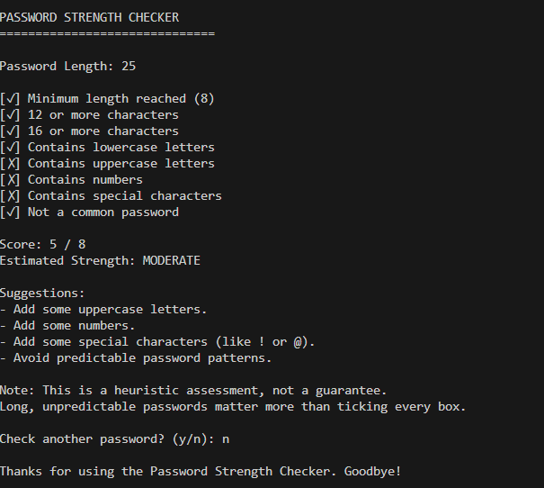

# Python Password Strength Checker

A beginner-friendly Python application that evaluates password strength using length, character variety, and common password patterns.

## Purpose

This project was developed to practise Python programming fundamentals while exploring basic password security concepts. It evaluates password characteristics and provides feedback to help users understand what makes a password more resistant to guessing.

The application evaluates a password locally and explains its weaknesses. It does **not** save passwords, send them to a server, or store them in a database.

## Features

- Hidden password input (`getpass`)
- Length checks (8, 12 and 16 characters)
- Lowercase, uppercase, number and special character checks
- Small sample common-password check
- Rule-based rating: Weak, Moderate, Strong, Very Strong
- Improvement suggestions

## Screenshots

### Character-checking results



## Requirements

- Python 3
- No external packages

## How to run (Windows 11, PowerShell)

```powershell
py -m venv .venv
.\.venv\Scripts\Activate.ps1
python main.py
```

## How to run the tests

```powershell
python -m unittest discover tests
```

## Example output

```
PASSWORD STRENGTH CHECKER
==============================

Password Length: 8

[✓] Minimum length reached (8)
[✗] 12 or more characters
[✗] 16 or more characters
[✓] Contains lowercase letters
[✗] Contains uppercase letters
[✓] Contains numbers
[✗] Contains special characters
[✗] Not a common password

Score: 3 / 8
Estimated Strength: WEAK
```

## Project structure

```
python-password-strength-checker/
├── main.py                  # terminal interface
├── password_checker.py      # checking and scoring logic
├── tests/
│   └── test_password_checker.py
├── docs/
│   └── PASSWORD-RULES.md    # scoring rules
├── screenshots/
├── .gitignore
├── README.md
└── LICENSE
```

## Scoring

See [docs/PASSWORD-RULES.md](docs/PASSWORD-RULES.md).

## Limitations

This is a heuristic assessment, not a guarantee that a password is secure. Long, unpredictable passwords and passphrases matter more than satisfying every character category. A real password-strength estimator needs more sophisticated analysis of predictability and guessing patterns.

## License

MIT License. See [LICENSE](LICENSE).
